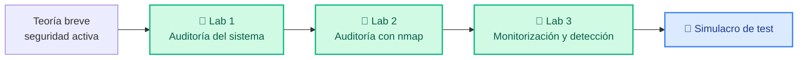

# Unidad 2 · Seguridad activa: auditoría y detección

| | |
|---|---|
| **Resultado de aprendizaje** | RA2 · Implanta mecanismos de seguridad activa |
| **Trimestre** | 1.º — se evalúa con **examen tipo test** |
| **Duración** | 16 horas |
| **Herramientas** | Python 3 · `psutil` · `nmap` · Docker Compose |

Esta unidad trata de **defender un sistema en marcha**: entender cómo se audita una red (qué equipos y servicios hay, si son vulnerables) y cómo se **detecta** un ataque leyendo lo que deja en los registros. Lo harás con **dos laboratorios** cortos y guiados paso a paso: primero te pones del lado del **auditor** (descubres y escaneas), y luego del lado del **defensor** (detectas en los logs lo que el auditor hizo). Son las dos caras de la misma moneda.

La evaluación es un **examen tipo test**; al final tienes un simulacro con el mismo formato.

## Cómo está organizada



## Preparación del entorno

Necesitas **Python 3** y **Docker** (con Docker Compose). Comprueba que están:

```bash
python --version          # 3.10 o superior
docker --version
docker compose version
```

Los dos laboratorios traen todos sus ficheros en las carpetas `labs/lab2/` y `labs/lab3/` del repositorio. Para el código Python que ejecutes fuera de Docker, crea un entorno virtual con una sola dependencia:

```text title="requirements.txt"
psutil==5.9.8
```

```bash
python -m venv .venv
source .venv/bin/activate      # Windows: .venv\Scripts\activate
pip install -r requirements.txt
```

!!! info "Solo una dependencia externa"
    En esta unidad lo único que se instala con `pip` es **psutil** (Lab 1, auditoría del sistema). El Lab 2 usa **nmap**, la herramienta estándar de escaneo, que se instala dentro de su contenedor. El Lab 3 solo usa la **biblioteca estándar** de Python (expresiones regulares, conteo, ficheros).

!!! info "Cómo se usan los laboratorios (resumen)"
    Cada laboratorio sigue siempre el mismo ciclo de tres comandos, desde la carpeta del lab:

    - **Arrancar:** `docker compose up -d --build` — construye y deja el contenedor vivo en segundo plano.
    - **Entrar y trabajar:** `docker compose exec <servicio> bash` — abres una terminal **como root** dentro del contenedor; ahí ejecutas los scripts (`python ...`) y, si quieres, instalas paquetes con `apt-get`.
    - **Parar:** `exit` para salir del contenedor y `docker compose down` para detenerlo y eliminarlo.

    El nombre del `<servicio>` es `auditor` en los labs 1 y 2, y `analista` en el lab 3 (lo ves en el `compose.yaml`). Los contenedores quedan **rulando** hasta que hagas `docker compose down`.

!!! danger "Norma de uso"
    Todo esto se practica **solo** dentro de los contenedores del laboratorio o en tu propia máquina. Escanear o auditar equipos ajenos sin permiso es delito. Ver [Uso ético y legal](../recursos/uso-etico.md).

## Teoría breve: seguridad activa

La **seguridad activa** son las medidas que **previenen o detienen** un incidente *mientras el sistema funciona* (un firewall que corta una conexión, un antivirus que bloquea un fichero, un sistema que detecta un ataque). Se distingue de la **seguridad pasiva**, que **reduce el daño una vez ocurrido** (copias de seguridad, redundancia, un SAI).

| | Seguridad activa | Seguridad pasiva |
|---|---|---|
| Cuándo actúa | **Antes y durante** el incidente | **Después** del incidente |
| Ejemplos | Firewall, antivirus, IDS/IPS | Copias de seguridad, redundancia, SAI |

Tres conceptos que conviene no confundir:

- **Amenaza:** lo que podría causar daño (un atacante, un malware). No la controlas.
- **Vulnerabilidad:** la debilidad que la amenaza aprovecha (un servicio sin actualizar). **Sí** la controlas.
- **Riesgo:** la probabilidad de que una amenaza explote una vulnerabilidad, por su impacto.

Y los mecanismos de defensa que aparecen en los laboratorios:

| Mecanismo | Qué hace |
|---|---|
| **Escáner / auditoría** | Descubre qué equipos y servicios hay, y si son vulnerables (Lab 1) |
| **IDS** (*Intrusion Detection System*) | **Detecta** actividad sospechosa en los registros y **avisa** (Lab 2) |
| **IPS** | Detecta **y además bloquea** el ataque |
| **NVD** (*National Vulnerability Database*) | Base pública de vulnerabilidades conocidas (los **CVE**) |

Dos diferencias que caen en el test: un **IDS** solo avisa, un **IPS** avisa y bloquea; y un **CVE** es el identificador público de una vulnerabilidad concreta (por ejemplo, `CVE-2021-23017`).
## 🧪 Lab 1 · Auditoría del propio sistema

**Objetivo.** Empezar por lo más cercano: **mirar tu propia máquina**. Antes de vigilar una red, un administrador audita el equipo: cuánta CPU y memoria se usan, qué procesos corren. Lo harás con **`psutil`**, la librería estándar para esto.

!!! tip "Ficheros del laboratorio"
    Están en `labs/lab1/`: `auditor_sistema.py`, `Dockerfile`, `compose.yaml` y `requirements.txt`.

### Paso 1 · El auditor del sistema

```python title="labs/lab1/auditor_sistema.py"
import psutil
import platform

print("=== Auditoría del sistema ===")
print("SO:", platform.system(), platform.release())
print("CPU:", psutil.cpu_percent(interval=0.3), "%")

mem = psutil.virtual_memory()
print(f"Memoria: {mem.percent}% usada ({mem.used // (1024**2)} MB de {mem.total // (1024**2)} MB)")

print("\n-- Procesos que más memoria usan --")
procesos = []
for p in psutil.process_iter(["pid", "name", "memory_percent"]):
    try:
        procesos.append((p.info["memory_percent"] or 0.0, p.info["pid"], p.info["name"]))
    except (psutil.NoSuchProcess, psutil.AccessDenied):
        continue
for mem_pct, pid, nombre in sorted(procesos, reverse=True)[:3]:
    print(f"  PID {pid:6}  {nombre:20}  {mem_pct:.1f}%")

print(f"\nTotal de procesos visibles: {len(procesos)}")
print("(Dentro de un contenedor, estos son los procesos DE ESE contenedor.)")
```

Tres detalles importantes:

- **`cpu_percent(interval=0.3)`** mide durante 0,3 s. Sin `interval`, la primera llamada devolvería `0.0` (no tiene un instante anterior con el que comparar).
- **`virtual_memory()`** da los valores en **bytes**; por eso dividimos entre `1024**2` para pasar a MB.
- El bucle **captura `NoSuchProcess` y `AccessDenied`**: un proceso puede terminar mientras lo leemos, o estar protegido. Sin ese `try/except`, el programa se rompería.

### Paso 2 · Levanta y ejecuta

```bash title="Terminal (dentro de labs/lab1/)"
# 1) Construye la imagen y levanta el contenedor (queda vivo en segundo plano)
docker compose up -d --build

# 2) Entra al contenedor (eres root: puedes instalar con apt si quieres)
docker compose exec auditor bash

# 3) Ya DENTRO del contenedor, ejecuta el script:
python auditor_sistema.py
```

**Salida esperada** (los números varían según tu máquina):

```text
=== Auditoría del sistema ===
SO: Linux 6.1.0
CPU: 0.0 %
Memoria: 3.1% usada (120 MB de 3997 MB)

-- Procesos que más memoria usan --
  PID      1  python                0.4%

Total de procesos visibles: 1
(Dentro de un contenedor, estos son los procesos DE ESE contenedor.)
```

### Paso 3 · Compara dentro y fuera del contenedor

Ejecuta ahora el mismo script **directamente en tu máquina** (sin Docker, con el entorno virtual activado):

```bash title="Terminal"
python labs/lab1/auditor_sistema.py
```

Verás **muchos más procesos**. ¿Por qué? Porque un contenedor está **aislado**: solo ve *sus propios* procesos, no los del equipo anfitrión. Para auditar la máquina real hay que ejecutar el script fuera de Docker.

!!! warning "Un proceso desconocido NO es automáticamente malicioso"
    Ver un proceso con un nombre que no reconoces es normal: el sistema ejecuta decenas de procesos legítimos. La auditoría da **datos**, no veredictos. Antes de alarmarte, investiga (qué ejecutable es, qué usuario lo lanza).

### Paso 4 · Apaga el laboratorio

```bash
# Primero sal del contenedor (si estás dentro):
exit
# Luego detén y elimina los contenedores:
docker compose down
```

!!! success "Lo que has hecho"
    Una auditoría básica del sistema: CPU, memoria y procesos. Es la primera capa de la monitorización, y has visto de paso que un contenedor está aislado del anfitrión.

## 🧪 Lab 2 · Auditoría de la red con nmap

**Objetivo.** Ponerte del lado del **auditor** usando la herramienta real que se emplea en el mundo profesional: **nmap**, el escáner de puertos y servicios más usado. Descubrirás qué puertos tiene abiertos un servidor, qué software y versión corre en ellos, y cruzarás esa información con una base de vulnerabilidades (la **NVD**) para generar un informe.

**Qué monta el laboratorio.** Dos contenedores en la misma red: un **servidor** (nginx) y el **auditor**, que lleva **nmap** ya instalado.

!!! tip "Ficheros del laboratorio"
    Están en `labs/lab2/`: `informe.py`, `Dockerfile` y `compose.yaml`. El `Dockerfile` instala nmap por ti.

### Paso 1 · Mira el laboratorio

El `compose.yaml` define el servidor y el auditor:

```yaml title="labs/lab2/compose.yaml"
services:
  # Objetivo de la auditoría: un servidor web con una versión concreta de nginx.
  servidor:
    image: nginx:1.18.0
    ports:
      - "8080:80"        # abre http://localhost:8080 en el navegador
    networks:
      - laboratorio

  # El auditor lleva nmap instalado. Corre como root y permanece vivo.
  auditor:
    build: .
    depends_on:
      - servidor
    networks:
      - laboratorio

networks:
  laboratorio:
```

El `Dockerfile` del auditor instala nmap:

```dockerfile title="labs/lab2/Dockerfile"
FROM python:3.12-slim
WORKDIR /app
RUN apt-get update && apt-get install -y --no-install-recommends nmap \
    && rm -rf /var/lib/apt/lists/*
COPY informe.py .
CMD ["sleep", "infinity"]
```

### Paso 2 · Levanta el laboratorio y entra en el auditor

```bash title="Terminal (dentro de labs/lab2/)"
docker compose up -d --build
docker compose exec auditor bash
```

Ya estás **dentro del contenedor auditor**, como root y con nmap listo.

### Paso 3 · Escanea con nmap

**a) Descubrimiento de puertos.** Qué puertos tiene abiertos el servidor:

```bash title="Dentro del contenedor auditor"
nmap servidor
```

```text title="Salida (aproximada)"
Nmap scan report for servidor (172.x.x.x)
PORT   STATE SERVICE
80/tcp open  http
```

nmap ha encontrado el puerto **80 abierto** (el servidor web). `servidor` es el nombre del contenedor en la red Docker.

**b) Detección de versiones** (la clave de una auditoría). La opción `-sV` averigua **qué software y versión** corre en cada puerto:

```bash title="Dentro del contenedor auditor"
nmap -sV servidor
```

```text title="Salida (aproximada)"
PORT   STATE SERVICE VERSION
80/tcp open  http    nginx 1.18.0
```

Ahora sabemos no solo que hay un servidor web, sino que es **nginx 1.18.0**. Con esa versión exacta se pueden buscar sus vulnerabilidades.

### Paso 4 · Genera el informe cruzando con la NVD

nmap puede guardar su resultado en **XML** (`-oX`) para procesarlo con un programa. Lánzalo así y luego ejecuta el informe:

```bash title="Dentro del contenedor auditor"
nmap -sV -oX resultado.xml servidor
python informe.py
```

El script `informe.py` lee ese XML y cruza cada versión con la NVD:

```python title="labs/lab2/informe.py"
import xml.etree.ElementTree as ET

# "NVD local": versiones vulnerables conocidas (extracto, para el laboratorio)
NVD_LOCAL = {
    ("nginx", "1.18.0"): "CVE-2021-23017 (resolver, gravedad alta)",
    ("Apache httpd", "2.4.49"): "CVE-2021-41773 (path traversal, crítico)",
    ("OpenSSH", "7.4"): "CVE-2018-15473 (enumeración de usuarios)",
    ("vsftpd", "2.3.4"): "CVE-2011-2523 (puerta trasera, crítico)",
}

# nmap guardó el resultado del escaneo en este fichero XML
arbol = ET.parse("resultado.xml")

print("=== Informe de auditoría ===\n")
vulnerables = 0
for puerto in arbol.iter("port"):
    estado = puerto.find("state").get("state")
    if estado != "open":
        continue
    servicio = puerto.find("service")
    producto = servicio.get("product", "") if servicio is not None else ""
    version = servicio.get("version", "") if servicio is not None else ""
    cve = NVD_LOCAL.get((producto, version), "")
    marca = f"VULNERABLE: {cve}" if cve else "sin vulnerabilidades conocidas"
    if cve:
        vulnerables += 1
    print(f"  Puerto {puerto.get('portid'):5}  {producto} {version:10}  {marca}")

print(f"\nResumen: {vulnerables} servicio(s) con vulnerabilidades conocidas.")
```

```text title="Salida"
=== Informe de auditoría ===

  Puerto 80     nginx 1.18.0      VULNERABLE: CVE-2021-23017 (resolver, gravedad alta)

Resumen: 1 servicio(s) con vulnerabilidades conocidas.
```

El informe ha detectado que nginx 1.18.0 tiene una vulnerabilidad conocida registrada en la NVD. **Eso es una auditoría**: descubrir → identificar versión → cruzar con vulnerabilidades.

### Paso 5 · Mira la web desde el navegador

El servidor que acabas de auditar es una web real. Como el `compose.yaml` publica su puerto, ábrela en tu navegador:

```text
http://localhost:8080
```

Verás la página de bienvenida de nginx: es lo que había detrás del puerto 80 que nmap marcó como abierto.

### Paso 6 · Apaga el laboratorio

```bash
# Sal del contenedor y detén todo:
exit
docker compose down
```

!!! success "Lo que has hecho"
    Una auditoría real con **nmap**, la herramienta que usan los profesionales: descubrimiento de puertos, detección de versiones (`-sV`) y cruce con la NVD para un informe. Es lo mismo que hacen herramientas como **OpenVAS** o **Nessus**, en pequeño.

> **Si quieres ir más allá:** prueba `nmap -A servidor` (análisis agresivo: sistema operativo, scripts, versiones a la vez) y observa cuánta más información obtiene.

## 🧪 Lab 3 · Monitorización y detección

**Objetivo.** Ahora te pones del lado del **defensor**. En el Lab 2 escaneaste y tanteaste un servidor; esas acciones **dejan rastro** en los registros (*logs*). Aquí vas a **detectarlas** usando primero las herramientas de línea de comandos que usa todo administrador (`grep`, `awk`, `sort`, `uniq`) y luego un pequeño detector en Python. Verás las **dos caras** de la misma acción.

!!! tip "Ficheros del laboratorio"
    Están en `labs/lab3/`: `auth.log`, `web.log`, `detector.py`, `Dockerfile` y `compose.yaml`.

### Paso 1 · Los registros que dejó el atacante

La IP `10.0.0.66` aparece en dos registros. En `auth.log`, intentando adivinar contraseñas:

```text title="labs/lab3/auth.log"
Failed password for root from 10.0.0.66 port 51000
Failed password for root from 10.0.0.66 port 51002
Failed password for admin from 10.0.0.66 port 51004
Failed password for admin from 10.0.0.66 port 51006
Accepted password for ana from 10.0.0.5 port 60000
```

Y en `web.log`, probando rutas que no existen (buscando páginas de administración, backups…):

```text title="labs/lab3/web.log"
10.0.0.66 - GET /index.html 200
10.0.0.66 - GET /admin 404
10.0.0.66 - GET /.env 404
10.0.0.66 - GET /wp-login.php 404
10.0.0.66 - GET /backup.zip 404
10.0.0.5 - GET /index.html 200
```

### Paso 2 · Levanta el laboratorio y entra

```bash title="Terminal (dentro de labs/lab3/)"
docker compose up -d --build
docker compose exec analista bash
```

### Paso 3 · Analiza los logs con herramientas de línea de comandos

Así es como un administrador mira un log rápidamente, sin programar nada. Dentro del contenedor:

**a) ¿Qué IPs han fallado al hacer login, y cuántas veces?**

```bash title="Dentro del contenedor"
grep "Failed password" auth.log | grep -oE "from [0-9.]+" | awk '{print $2}' | sort | uniq -c | sort -rn
```

```text title="Salida"
      4 10.0.0.66
```

Cada orden hace una parte: `grep` filtra las líneas de fallo, `awk` saca la IP, y `sort | uniq -c` las cuenta. La IP `10.0.0.66` ha fallado **4 veces**: patrón de fuerza bruta.

**b) ¿Qué IPs han provocado muchos errores 404 (rutas inexistentes)?**

```bash title="Dentro del contenedor"
grep " 404$" web.log | awk '{print $1}' | sort | uniq -c | sort -rn
```

```text title="Salida"
      4 10.0.0.66
```

La misma IP ha pedido **4 rutas que no existen**: está rastreando el servidor buscando puntos de entrada.

### Paso 4 · Automatiza la detección con Python

Hacerlo a mano está bien para entender, pero conviene automatizarlo. `detector.py` hace lo mismo y lanza una **alerta** cuando se supera un umbral (un mini-IDS):

```python title="labs/lab3/detector.py"
import re
from collections import Counter

UMBRAL = 3

# 1) auth.log: contar fallos de login por IP
fallos = Counter()
with open("auth.log", encoding="utf-8") as f:
    for linea in f:
        m = re.search(r"Failed password .* from (\d+\.\d+\.\d+\.\d+)", linea)
        if m:
            fallos[m.group(1)] += 1

# 2) web.log: contar errores 404 por IP (rutas que no existen)
rutas_404 = Counter()
with open("web.log", encoding="utf-8") as f:
    for linea in f:
        m = re.search(r"(\d+\.\d+\.\d+\.\d+).* 404$", linea.strip())
        if m:
            rutas_404[m.group(1)] += 1

print("Fallos de login por IP:", dict(fallos))
print("Errores 404 por IP:    ", dict(rutas_404))

# 3) Alertas: IP que supera el umbral en login o en rutas
print("\n--- ALERTAS ---")
for ip in sorted(set(fallos) | set(rutas_404)):
    motivos = []
    if fallos[ip] >= UMBRAL:
        motivos.append(f"fuerza bruta ({fallos[ip]} fallos de login)")
    if rutas_404[ip] >= UMBRAL:
        motivos.append(f"rastreo de rutas ({rutas_404[ip]} rutas inexistentes)")
    if motivos:
        print(f"  [ALERTA] {ip}: " + " + ".join(motivos))
```

Ejecútalo:

```bash title="Dentro del contenedor"
python detector.py
```

```text title="Salida"
Fallos de login por IP: {'10.0.0.66': 4}
Errores 404 por IP:     {'10.0.0.66': 4}

--- ALERTAS ---
  [ALERTA] 10.0.0.66: fuerza bruta (4 fallos de login) + rastreo de rutas (4 rutas inexistentes)
```

### Paso 5 · Apaga el laboratorio

```bash
exit
docker compose down
```

!!! success "Las dos caras de la moneda"
    La misma IP (`10.0.0.66`) que en el Lab 2 era *tu auditor*, aquí aparece como *el atacante detectado*: por fuerza bruta en `auth.log` y por rastreo de rutas en `web.log`. **Auditar y detectar son la misma acción vista desde los dos lados.** En el mundo real, herramientas como **fail2ban** hacen esto automáticamente: leen los logs y bloquean la IP que supera un umbral de fallos.

> **Nota sobre falsos positivos.** Superar un umbral es un **patrón sospechoso que hay que verificar**, no una prueba de ataque: podría ser un script mal configurado. Un umbral muy bajo genera falsas alarmas; uno muy alto deja pasar ataques lentos.

## Actividades

Estas actividades nacen directamente de los labs. Algunas piden que **pruebes algo** modificando el código o los comandos; otras piden que **pienses** sobre lo que viste.

### Lab 1 · psutil

**A1.** Ejecutaste `auditor_sistema.py` dentro del contenedor y viste solo 1 proceso. Ahora ejecútalo **directamente en tu máquina** (sin Docker). ¿Cuántos procesos ves? Explica en una frase por qué la diferencia.

**A2.** En `auditor_sistema.py` la línea es `psutil.cpu_percent(interval=0.3)`. Cambia `interval=0.3` por nada, es decir, `psutil.cpu_percent()`. ¿Qué valor da ahora la primera vez que se ejecuta? ¿Por qué?

**A3.** El bucle de procesos captura dos excepciones: `NoSuchProcess` y `AccessDenied`. ¿Qué pasaría si eliminaras el `try/except` y un proceso terminara justo mientras lo lees?

### Lab 2 · nmap

**A4.** En el Lab 2 ejecutaste `nmap servidor` y luego `nmap -sV servidor`. ¿Qué información adicional te da la segunda que no da la primera? ¿Por qué esa información extra es útil para una auditoría?

**A5.** El script `informe.py` cruza la versión detectada con `NVD_LOCAL`. Si el servidor estuviera corriendo `Apache/2.4.49` en vez de nginx, ¿qué CVE aparecería en el informe? Búscalo en el diccionario del código y escribe la respuesta.

**A6.** ¿Por qué desde el contenedor `auditor` puedes hacer `nmap servidor` usando el nombre `servidor`, pero desde tu terminal (fuera de Docker) ese nombre no funcionaría?

### Lab 3 · Monitorización

**A7.** En el Lab 3 ejecutaste:
```bash
grep "Failed password" auth.log | grep -oE "from [0-9.]+" | awk '{print $2}' | sort | uniq -c | sort -rn
```
Explica qué hace cada parte separada por `|`. ¿Qué ocurriría si quitaras el último `sort -rn`?

**A8.** El detector usa `UMBRAL = 3`. Cambia el umbral a `1` y vuelve a ejecutar `detector.py`. ¿Qué IPs se marcan ahora? ¿Es eso un problema? ¿Cómo se llama este tipo de resultado en seguridad?

**A9.** La IP `10.0.0.66` aparece como atacante tanto en `auth.log` como en `web.log`. ¿Qué dos tipos de ataque distintos estaba realizando simultáneamente? ¿Qué tiene de útil detectar los dos a la vez?

## Cómo se evalúa esta unidad (RA2)

La UT1 y la UT2 forman el **1.er trimestre**. Cada una se evalúa por separado con un **examen tipo test de 20 preguntas**, 4 opciones y una sola respuesta correcta.

!!! tip "La nota, sin sorpresas"
    **Nota = (aciertos − fallos ÷ 3) ÷ 20 × 10**

    - Acertar suma 1 punto. Fallar resta ⅓ de punto. Dejar en blanco no penaliza.
    - Se necesita **5 o más** para superar el RA.
    - Ejemplo: 14 aciertos y 4 fallos → (14 − 4/3) / 20 × 10 = **6,3**

## Simulacro de examen tipo test

> 15 preguntas. Mezclan teoría y cosas que viste en los labs. Una sola respuesta correcta.

**1.** Ejecutaste `auditor_sistema.py` dentro del contenedor y obtuviste esta salida:

```text
=== Auditoría del sistema ===
SO: Linux 6.1.0
CPU: 0.0 %
Memoria: 3.1% usada (120 MB de 3997 MB)

-- Procesos que más memoria usan --
  PID      1  python                0.4%

Total de procesos visibles: 1
(Dentro de un contenedor, estos son los procesos DE ESE contenedor.)
```

¿Por qué solo aparece **1 proceso**?

- A) `psutil` tiene un bug dentro de Docker
- B) El contenedor está aislado y solo ve sus propios procesos, no los del anfitrión
- C) El sistema operativo del contenedor es diferente
- D) Falta instalar una dependencia

<details class="sol"><summary>Ver respuesta</summary><b>Correcta: B.</b> El aislamiento de contenedores hace que cada uno vea solo sus propios procesos. Es una característica de seguridad, no un error.</details>

**2.** En `auditor_sistema.py`, la primera llamada a `psutil.cpu_percent()` sin `interval` devuelve `0.0`. ¿Por qué?

- A) Porque la CPU está al 0% en ese momento
- B) Porque sin `interval` no tiene un instante anterior con el que comparar el uso
- C) Porque `psutil` no funciona correctamente
- D) Porque el contenedor no tiene CPU asignada

<details class="sol"><summary>Ver respuesta</summary><b>Correcta: B.</b> El porcentaje de CPU es una comparación entre dos momentos. La primera llamada sin <code>interval</code> no tiene punto de referencia, así que devuelve 0.0.</details>

**3.** En el Lab 2 lanzaste dos comandos y obtuviste estas salidas:

```text
$ nmap servidor
PORT   STATE SERVICE
80/tcp open  http

$ nmap -sV servidor
PORT   STATE SERVICE VERSION
80/tcp open  http    nginx 1.18.0
```

¿Qué información da `-sV` que no da el primer comando?

- A) No hay diferencia, son equivalentes
- B) `nmap servidor` solo descubre puertos abiertos; `-sV` además detecta el software y su versión
- C) `-sV` es más rápido
- D) `nmap servidor` detecta versiones; `-sV` solo puertos

<details class="sol"><summary>Ver respuesta</summary><b>Correcta: B.</b> Sin <code>-sV</code> nmap solo dice "puerto 80 abierto". Con <code>-sV</code> dice "puerto 80, nginx 1.18.0" — esa versión es la clave para buscar vulnerabilidades.</details>

**4.** Tras ejecutar `nmap -sV servidor` obtuviste `nginx 1.18.0`. Luego ejecutaste `python informe.py` y viste:

```text
=== Informe de auditoría ===

  Puerto    80  nginx 1.18.0      VULNERABLE: CVE-2021-23017 (resolver, gravedad alta)

Resumen: 1 servicio(s) con vulnerabilidades conocidas.
```

¿Qué hizo `informe.py` con la versión detectada?

- A) Para cerrar ese puerto
- B) Para cruzarla con la NVD y encontrar que tiene el CVE-2021-23017
- C) Para saber qué sistema operativo usa el servidor
- D) Para descifrar el tráfico

<details class="sol"><summary>Ver respuesta</summary><b>Correcta: B.</b> El script <code>informe.py</code> cruza la versión detectada con <code>NVD_LOCAL</code> y encuentra que <code>nginx/1.18.0</code> tiene una vulnerabilidad conocida registrada.</details>

**5.** En el Lab 2 guardaste el resultado de nmap con `-oX resultado.xml` y luego `informe.py` lo leyó así:

```python
import xml.etree.ElementTree as ET
arbol = ET.parse("resultado.xml")
for puerto in arbol.iter("port"):
    servicio = puerto.find("service")
    producto = servicio.get("product", "")
    version  = servicio.get("version", "")
```

¿Por qué usar XML en lugar de la salida de texto de nmap?

- A) Porque XML ocupa menos espacio
- B) Porque XML puede leerse con un programa; así `informe.py` lo procesa automáticamente
- C) Porque nmap no puede mostrar en pantalla
- D) Por motivos de seguridad

<details class="sol"><summary>Ver respuesta</summary><b>Correcta: B.</b> El XML es un formato estructurado que Python puede parsear con <code>ElementTree</code>. Permite automatizar el análisis en vez de leer la pantalla a mano.</details>

**6.** ¿Qué es un **CVE**?

- A) Un tipo de antivirus
- B) El identificador único de una vulnerabilidad conocida y publicada
- C) Un algoritmo de cifrado
- D) Un tipo de firewall

<details class="sol"><summary>Ver respuesta</summary><b>Correcta: B.</b> CVE (Common Vulnerabilities and Exposures) es el identificador estándar de vulnerabilidades, como CVE-2021-23017. La NVD las recoge todas.</details>

**7.** En el Lab 3 ejecutaste este comando y obtuviste `4 10.0.0.66`. ¿Qué significa ese resultado?

```bash
grep "Failed password" auth.log | grep -oE "from [0-9.]+" | awk '{print $2}' | sort | uniq -c | sort -rn
```

- A) La IP 10.0.0.66 tiene 4 puertos abiertos
- B) La IP 10.0.0.66 ha fallado 4 veces al intentar hacer login
- C) Hay 4 usuarios con contraseña incorrecta
- D) El servidor ha reiniciado 4 veces

<details class="sol"><summary>Ver respuesta</summary><b>Correcta: B.</b> El comando filtra las líneas de fallo de login, extrae la IP y las cuenta. "4 10.0.0.66" significa que esa IP acumuló 4 intentos fallidos.</details>

**8.** En el Lab 3, `web.log` contenía estas líneas:

```text
10.0.0.66 - GET /admin 404
10.0.0.66 - GET /.env 404
10.0.0.66 - GET /wp-login.php 404
10.0.0.66 - GET /backup.zip 404
10.0.0.5  - GET /index.html 200
```

Al ejecutar `grep " 404$" web.log | awk '{print $1}' | sort | uniq -c | sort -rn` obtuviste `4 10.0.0.66`. ¿Qué estaba haciendo esa IP?

- A) Descargando ficheros grandes
- B) Probando rutas que no existen, buscando páginas de administración o backups
- C) Actualizando el servidor
- D) Navegando con normalidad

<details class="sol"><summary>Ver respuesta</summary><b>Correcta: B.</b> Pedir muchas rutas inexistentes (/admin, /.env, /wp-login.php…) es rastreo de rutas: el atacante busca puntos de entrada o ficheros sensibles.</details>

**9.** En `detector.py` el detector lanza alertas así:

```python
UMBRAL = 3
for ip, n in fallos.items():
    if n >= UMBRAL:
        print(f"  [ALERTA] {ip}: fuerza bruta ({n} fallos de login)")
```

Con los datos del lab, `10.0.0.66` tenía 4 fallos y `10.0.0.5` tenía 1. ¿Para qué sirve el `UMBRAL = 3`?

- A) Que el programa sea demasiado lento
- B) Que se generen alertas por uno o dos intentos normales (falsos positivos)
- C) Que el fichero de log sea demasiado grande
- D) Que Python lance una excepción

<details class="sol"><summary>Ver respuesta</summary><b>Correcta: B.</b> Un usuario puede equivocarse una vez al escribir su contraseña. El umbral evita generar una alerta de fuerza bruta por eso; solo alerta cuando el patrón es repetido.</details>

**10.** En el Lab 2, el auditor usó la IP `10.0.0.66`. En el Lab 3, al analizar los logs obtuviste:

```text
Fallos de login por IP: {'10.0.0.66': 4}
Errores 404 por IP:     {'10.0.0.66': 4}

--- ALERTAS ---
  [ALERTA] 10.0.0.66: fuerza bruta (4 fallos de login) + rastreo de rutas (4 rutas inexistentes)
```

¿Qué relación hay entre lo que hizo el auditor y lo que detectó el Lab 3?

- A) Que hay un error en el laboratorio
- B) Que las acciones del auditor dejan rastro en los logs, y el defensor puede detectarlas
- C) Que los dos labs usan la misma IP por casualidad
- D) Que la IP pertenece al servidor

<details class="sol"><summary>Ver respuesta</summary><b>Correcta: B.</b> Es la misma acción vista desde los dos lados: escanear y tantear deja huella en logs y tráfico. El defensor detecta exactamente lo que el auditor hizo.</details>

**11.** El `detector.py` del Lab 3 hace esto cuando detecta un patrón:

```python
if fallos[ip] >= UMBRAL:
    motivos.append(f"fuerza bruta ({fallos[ip]} fallos de login)")
if motivos:
    print(f"  [ALERTA] {ip}: " + " + ".join(motivos))
```

Imprime la alerta pero no bloquea nada. ¿Cómo se llama este tipo de herramienta, y en qué se diferencia de una que sí bloquea?

- A) Son lo mismo
- B) El IDS avisa cuando detecta algo sospechoso; el IPS además lo bloquea automáticamente
- C) El IDS bloquea; el IPS avisa
- D) El IDS vigila ficheros; el IPS vigila la red

<details class="sol"><summary>Ver respuesta</summary><b>Correcta: B.</b> El detector Python del Lab 3 es un IDS básico: detecta y avisa. Un IPS iría más lejos y bloquearía la IP automáticamente.</details>

**12.** ¿Qué imprime este fragmento de `informe.py` si `producto = "nginx"` y `version = "1.18.0"`?

```python
NVD_LOCAL = {
    ("nginx", "1.18.0"): "CVE-2021-23017 (resolver, gravedad alta)",
}
cve = NVD_LOCAL.get(("nginx", "1.18.0"), "")
marca = f"VULNERABLE: {cve}" if cve else "sin vulnerabilidades conocidas"
print(marca)
```

- A) `sin vulnerabilidades conocidas`
- B) `VULNERABLE: CVE-2021-23017 (resolver, gravedad alta)`
- C) `("nginx", "1.18.0")`
- D) `None`

<details class="sol"><summary>Ver respuesta</summary><b>Correcta: B.</b> La clave <code>("nginx", "1.18.0")</code> existe en el diccionario, así que <code>cve</code> no es vacío y se imprime la cadena <code>VULNERABLE: ...</code>.</details>

**13.** ¿Qué hace la seguridad **activa** que no hace la pasiva?

- A) Guarda copias de seguridad
- B) Previene o detiene el incidente mientras ocurre
- C) Mantiene el sistema encendido con un SAI
- D) Proporciona servidores redundantes

<details class="sol"><summary>Ver respuesta</summary><b>Correcta: B.</b> La seguridad activa actúa antes y durante el incidente (firewall, IDS, antivirus). La pasiva reduce el daño después (copias, redundancia).</details>

**14.** El `compose.yaml` del Lab 2 define el servidor así:

```yaml
services:
  servidor:
    image: nginx:1.18.0
    networks:
      - laboratorio
  auditor:
    build: .
    networks:
      - laboratorio
```

¿Puedes abrir `http://localhost:80` en tu navegador y ver la web del servidor?

- A) Sí, siempre que sepas su IP
- B) No, sin `ports:` el servidor no es accesible desde fuera de la red Docker
- C) Sí, usando el nombre `servidor`
- D) Solo si usas HTTPS

<details class="sol"><summary>Ver respuesta</summary><b>Correcta: B.</b> Sin <code>ports:</code>, Docker no crea ningún puente entre la red del contenedor y tu máquina. Solo otros contenedores en la misma red pueden llegar a él.</details>

**15.** Que una IP supere el umbral de fallos en el detector, ¿demuestra definitivamente que hay un ataque?

- A) Sí, es prueba suficiente
- B) No; es un patrón sospechoso que hay que investigar, puede ser un script mal configurado
- C) Sí, hay que bloquearla inmediatamente
- D) No significa nada relevante

<details class="sol"><summary>Ver respuesta</summary><b>Correcta: B.</b> El umbral es una señal para investigar. Un resultado automático nunca es prueba definitiva: puede ser un falso positivo.</details>
