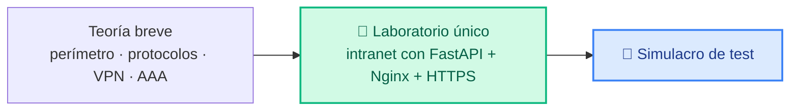
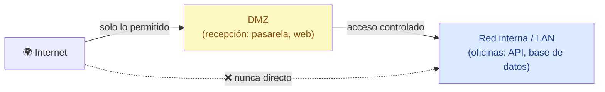
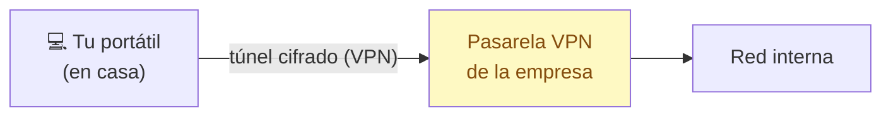
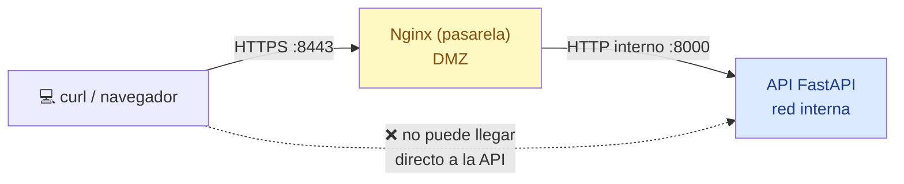

# Unidad 3 · Seguridad perimetral y acceso remoto

| | |
|---|---|
| **Resultado de aprendizaje** | RA3 · Implanta seguridad perimetral y acceso remoto |
| **Trimestre** | 2.º |
| **Duración** | 14 horas |
| **Herramientas** | Docker Compose · FastAPI · Nginx · `curl` · Python |

El **perímetro** de una red es su frontera con el exterior. Esta unidad trata de cómo se protege esa frontera (cortafuegos, DMZ, segmentación) y de cómo se permite el **acceso remoto seguro** (protocolos cifrados, pasarelas, VPN). La teoría es breve y va directa a la práctica: construirás **un único laboratorio** que monta la intranet de una empresa pequeña, con una API privada detrás de una pasarela, y comprobarás tú mismo por qué está protegida.

!!! info "Esta unidad se evalúa con test"
    El laboratorio es la forma de **entender** los conceptos montándolos. La calificación es un **examen tipo test**; al final tienes un simulacro.



## Parte 1 · Teoría

### 1.1 Seguridad perimetral: Internet, red interna y DMZ

Imagina una empresa como un edificio. **Internet** es la calle; la **red interna (LAN)** son las oficinas privadas donde está lo valioso (bases de datos, ficheros); y la **DMZ** (*zona desmilitarizada*) es como la **recepción**: una zona intermedia donde se atiende al público sin dejarle entrar en las oficinas.



La regla de oro: **desde Internet nunca se llega directamente a la red interna**. Lo que da la cara (una web, una pasarela) vive en la DMZ; si alguien la compromete, todavía tiene otra barrera antes de llegar a lo importante.

- **Cortafuegos (firewall):** el portero que decide qué tráfico pasa, según reglas.
- **Segmentación de redes:** dividir la red en zonas aisladas, de modo que un problema en una no contamine las demás. Es lo que harás con las dos redes Docker del laboratorio.

#### Puertos TCP: las puertas del servidor

Imagina el servidor como un edificio con **65 535 puertas numeradas**. Cada servicio escucha detrás de una puerta concreta y espera que alguien llame. Cuando tu navegador escribe `https://servidor`, llama siempre a la puerta **443** porque HTTPS tiene ese número asignado por convenio internacional.

```
Puerto  Servicio         ¿Lo viste en el curso?
──────  ───────────────  ──────────────────────
   22   SSH              UT3 · acceso remoto cifrado
   80   HTTP             UT3 · Nginx recibe y redirige a 443
  443   HTTPS            UT3 · Nginx con TLS (lab: puerto 8443)
 3306   MySQL/MariaDB    UT2 · nmap lo escaneó en el Lab 2
 8000   API del lab      UT3 · FastAPI, solo accesible desde la red interna
 8443   HTTPS del lab    UT3 · puerto no estándar para no necesitar root
```

Tres estados posibles cuando nmap (o `curl`) intenta conectarse a un puerto:

| Estado | Qué significa | Ejemplo en el curso |
|---|---|---|
| **open** | Hay un servicio escuchando | Puerto 80 en el Lab 2 de UT2 |
| **closed** | El sistema responde pero nadie escucha → *Connection refused* | Puertos 22, 443… en el Lab 2 |
| **filtered** | Un firewall descarta el paquete sin responder | Lo que hace el FW exterior en la DMZ |

La regla de oro para un administrador: **cuantos menos puertos abiertos, menor es la superficie de ataque**. Cada puerta abierta es una que un atacante puede intentar cruzar.

!!! tip "Puertos no estándar"
    En el laboratorio usamos el **8443** en vez del 443 y el **8080** en vez del 80. Los puertos por debajo del 1024 requieren permisos de administrador (root) para usarlos. En desarrollo se usan puertos altos para no necesitar sudo.

### 1.2 Protocolos seguros: HTTP/HTTPS, TLS y SSH

| Protocolo | Para qué | ¿Cifrado? |
|---|---|---|
| **HTTP** | Navegación web | ❌ No: todo viaja en claro |
| **HTTPS** | Navegación web segura | ✅ Sí, con **TLS** |
| **SSH** | Administración remota de un servidor (terminal) | ✅ Sí |

**HTTPS** no es un protocolo nuevo: es **HTTP sobre TLS**. **TLS** (*Transport Layer Security*) es la capa que cifra la comunicación y, mediante un **certificado**, garantiza que hablas con quien crees (recuerda los certificados de la UT1). Por eso el candado del navegador significa "cifrado + identidad verificada".

**SSH** (*Secure Shell*) permite abrir una terminal en un servidor remoto de forma cifrada. Sustituyó a Telnet, que enviaba las contraseñas en claro. Un comando típico:

```bash
ssh usuario@servidor        # abre una sesión remota cifrada
```

### 1.3 VPN: una red privada sobre una pública

Una **VPN** (*Virtual Private Network*) crea un **túnel cifrado** entre tu equipo y la red de la empresa a través de Internet. Es como tener un cable privado hasta la oficina, aunque estés en casa: todo lo que viaja por el túnel va cifrado y, para la red de la empresa, es como si estuvieras dentro.



Elementos de una VPN: el **túnel** (el canal cifrado), las **claves** (para cifrar y autenticar los extremos) y las **rutas** (qué tráfico va por el túnel y cuál no). Ejemplos reales: WireGuard, OpenVPN, IPsec.

### 1.4 Acceso remoto: pasarelas, autenticación, autorización y control de acceso

Cuando alguien accede desde fuera, el acceso pasa por una **pasarela** (*gateway*): un único punto de entrada que concentra los controles. En el laboratorio, esa pasarela será **Nginx**. Sobre ella se aplican las **tres A (AAA)**:

| | Pregunta | En el laboratorio |
|---|---|---|
| **Autenticación** | ¿Quién eres? | La cabecera `X-Token` de la API |
| **Autorización** | ¿Qué puedes hacer? | Sin token válido → `401` (denegado) |
| **Auditoría** (*accounting*) | ¿Qué hiciste y cuándo? | Los registros de Nginx y de la API |

### 1.5 Autenticación centralizada: RADIUS

En una empresa con muchos usuarios y servicios, no tiene sentido que cada servicio tenga su propia lista de contraseñas. **RADIUS** es un protocolo que **centraliza** la autenticación: los servicios preguntan a un servidor RADIUS "¿este usuario y contraseña son válidos?", y él responde. Así hay **una sola** fuente de identidades (altas, bajas y cambios en un único sitio). Se usa mucho en wifi corporativas y VPN. No lo montaremos, pero debes reconocer **qué problema resuelve**: evitar tener las credenciales repartidas por todos lados.

!!! note "Lo esencial de la teoría para el test"
    DMZ = zona intermedia; Internet nunca llega directo a la LAN. HTTPS = HTTP + TLS (cifrado + identidad). SSH = terminal remota cifrada (sustituye a Telnet). VPN = túnel cifrado (túnel + claves + rutas). Pasarela = punto único de entrada. AAA = autenticación/autorización/auditoría. RADIUS = autenticación centralizada.
## Parte 2 · Laboratorio: acceso seguro a una intranet

Vas a montar la intranet de una empresa pequeña: una **API privada** (FastAPI) con datos de empleados, protegida detrás de una **pasarela Nginx** con **HTTPS**. La API **nunca** se expone directamente a Internet: solo se llega a ella a través de la pasarela. Comprobarás el aislamiento, los códigos HTTP y el cifrado, y automatizarás las pruebas con Python.



!!! tip "Ficheros listos para usar"
    Todo el laboratorio está en la carpeta **`lab/`** del repositorio del curso, con esta estructura. No tienes que copiar nada a mano:

    ```text
    lab/
    ├── compose.yaml              # define servicios y redes
    ├── generar_certificado.sh    # crea el certificado de laboratorio
    ├── pruebas.py                # pruebas de conectividad en Python
    ├── requirements-pruebas.txt
    ├── api/                      # la API privada (FastAPI)
    │   ├── app.py
    │   ├── Dockerfile
    │   └── requirements.txt
    └── nginx/                    # la pasarela
        ├── nginx.conf
        └── Dockerfile
    ```

### Paso 1 · Los servicios y las redes (Docker Compose)

El `compose.yaml` define **dos servicios** y, sobre todo, **dos redes**, que es donde está la seguridad:

```yaml title="lab/compose.yaml"
services:
  # Pasarela: única cara visible. Está en la DMZ (publicada) y en la red interna.
  nginx:
    build: ./nginx
    ports:
      - "8080:80"      # HTTP del host -> redirige a HTTPS
      - "8443:443"     # HTTPS del host -> pasarela
    volumes:
      - ./nginx/certs:/etc/nginx/certs:ro
    networks:
      - dmz
      - interna
    depends_on:
      - api
    security_opt:
      - no-new-privileges:true

  # API: SOLO en la red interna. No tiene 'ports', así que el host no la ve.
  api:
    build: ./api
    networks:
      - interna
    security_opt:
      - no-new-privileges:true

networks:
  dmz:
  interna:
    internal: true     # esta red no tiene salida a internet: aislamiento
```

**Lo importante:** la API **no tiene `ports`**. Eso significa que desde tu ordenador (el host) **no existe** una forma de llamarla directamente: solo es alcanzable desde dentro de la red `interna`, donde también está Nginx. La pasarela es el único puente.

### Paso 2 · La API con FastAPI

**FastAPI** es un framework de Python para crear APIs web rápidamente. La nuestra tiene tres *endpoints* y exige un **token** para los datos sensibles:

```python title="lab/api/app.py"
from fastapi import FastAPI, HTTPException, Header

app = FastAPI(title="Intranet API")

EMPLEADOS = {
    1: {"nombre": "Ana García", "departamento": "Sistemas"},
    2: {"nombre": "Luis Pérez", "departamento": "Ventas"},
}
TOKEN_VALIDO = "secreto-de-laboratorio"

@app.get("/salud")
def salud():
    """Comprobación de vida del servicio (no requiere token)."""
    return {"estado": "ok"}

@app.get("/empleados")
def listar(x_token: str = Header(default="")):
    """Lista los empleados. Requiere cabecera X-Token válida."""
    if x_token != TOKEN_VALIDO:
        raise HTTPException(status_code=401, detail="token no válido")
    return list(EMPLEADOS.values())

@app.get("/empleados/{id}")
def obtener(id: int, x_token: str = Header(default="")):
    """Devuelve un empleado por su id. Requiere token válido."""
    if x_token != TOKEN_VALIDO:
        raise HTTPException(status_code=401, detail="token no válido")
    if id not in EMPLEADOS:
        raise HTTPException(status_code=404, detail="no existe")
    return EMPLEADOS[id]
```

- `/salud` es público: sirve para comprobar que el servicio vive.
- `/empleados` y `/empleados/{id}` exigen la cabecera `X-Token`. Sin ella, devuelven **401** (no autorizado): esto es la **autenticación** de las AAA.

### Paso 3 · Generar el certificado de laboratorio

HTTPS necesita un certificado. Como es un laboratorio, creamos uno **autofirmado** (válido para pruebas, no para producción). El script usa `openssl`:

```bash title="lab/generar_certificado.sh"
#!/bin/sh
mkdir -p nginx/certs
openssl req -x509 -newkey rsa:2048 -nodes \
    -keyout nginx/certs/key.pem \
    -out nginx/certs/cert.pem \
    -days 365 \
    -subj "/CN=intranet.local"
echo "Certificado creado en nginx/certs/"
```

Ejecútalo una vez antes de levantar los contenedores:

```bash title="Terminal (dentro de lab/)"
sh generar_certificado.sh
```

### Paso 4 · Nginx como pasarela (sin exponer la API)

Nginx recibe las peticiones de fuera y las **reenvía** a la API por la red interna. Además, obliga a usar HTTPS: si alguien entra por HTTP (puerto 80), lo redirige a HTTPS (443).

```nginx title="lab/nginx/nginx.conf"
events {}

http {
    # Redirige todo el tráfico HTTP (80) a HTTPS (443)
    server {
        listen 80;
        return 301 https://$host$request_uri;
    }

    # Punto de entrada seguro
    server {
        listen 443 ssl;
        server_name intranet.local;

        ssl_certificate     /etc/nginx/certs/cert.pem;
        ssl_certificate_key /etc/nginx/certs/key.pem;

        # Reenvía las peticiones a la API, que vive en la red interna
        location / {
            proxy_pass http://api:8000;
            proxy_set_header Host $host;
        }
    }
}
```

Fíjate en `proxy_pass http://api:8000`: Nginx llama a la API por su **nombre de servicio** (`api`), que solo se resuelve **dentro** de la red Docker. El `301` de la primera sección es una **redirección permanente** a HTTPS.

**Levanta todo el laboratorio:**

```bash title="Terminal (dentro de lab/)"
docker compose up --build -d
```

### Paso 5 · Probar los endpoints con `curl` y ver los códigos HTTP

Ahora comprueba el comportamiento desde fuera. La opción `-k` le dice a `curl` que acepte el certificado autofirmado (solo en laboratorio); `-i` muestra la cabecera con el código HTTP.

```bash title="Terminal"
# 1) Salud del servicio (público) -> 200 OK
curl -k https://localhost:8443/salud

# 2) Listar empleados SIN token -> 401 (no autorizado)
curl -k -i https://localhost:8443/empleados

# 3) Listar empleados CON token -> 200 OK
curl -k -H "X-Token: secreto-de-laboratorio" https://localhost:8443/empleados

# 4) Un empleado que no existe -> 404
curl -k -H "X-Token: secreto-de-laboratorio" https://localhost:8443/empleados/99

# 5) Entrar por HTTP -> 301 (redirige a HTTPS)
curl -i http://localhost:8080/salud
```

| Petición | Código esperado | Qué demuestra |
|---|---|---|
| `/salud` | `200` | El servicio funciona |
| `/empleados` sin token | `401` | La autenticación protege los datos |
| `/empleados` con token | `200` | Con credencial válida, hay acceso |
| `/empleados/99` | `404` | El recurso no existe |
| `http://...` (puerto 80) | `301` | Se fuerza el uso de HTTPS |

### Paso 6 · Comprobar el aislamiento entre redes

Aquí se ve por qué la arquitectura es segura. Intenta llamar a la API **directamente**, saltándote la pasarela:

```bash title="Terminal"
# La API escucha en el 8000, pero DENTRO de la red interna.
# Desde el host no hay ningún puerto publicado hacia ella:
curl http://localhost:8000/salud
```

```text title="Resultado"
curl: (7) Failed to connect to localhost port 8000: Connection refused
```

**No se puede.** La API no tiene ningún puerto publicado hacia el host: solo Nginx puede hablar con ella, porque comparten la red `interna`. Puedes confirmar que Nginx **sí** la alcanza desde dentro:

```bash title="Terminal"
docker compose exec nginx wget -qO- http://api:8000/salud
```

```text title="Resultado"
{"estado":"ok"}
```

Esto es la **segmentación de redes** en acción: la API está en una zona aislada (`internal: true`, sin salida a Internet) y solo la pasarela, que hace de puente controlado, puede llegar a ella.

### Paso 7 · SSH y VPN: demostración de acceso remoto

La pasarela web protege el acceso a la *aplicación*. Para administrar el *servidor* se usa **SSH**, y para meter todo tu equipo *dentro* de la red de la empresa, una **VPN**.

**SSH** (demostración conceptual): conectarte a un servidor sería tan simple como:

```bash title="Terminal (ejemplo)"
ssh admin@servidor-intranet       # terminal remota cifrada
```

Todo lo que escribes y recibes va cifrado. Nadie que capture el tráfico (recuerda Scapy, UT2) puede leer tu contraseña ni tus comandos, al contrario que con el antiguo Telnet.

**VPN** (idea): si levantaras un servidor WireGuard en la DMZ, tu portátil establecería un túnel cifrado y entraría en la red `interna` como si estuviera físicamente en la oficina — entonces **sí** podrías llamar a `http://api:8000` directamente, porque estarías *dentro*. La VPN te convierte en un miembro más de la red interna, de forma segura.

### Paso 8 · Automatizar las pruebas con Python

Hacer las pruebas a mano con `curl` está bien para aprender, pero en la práctica se **automatizan**. Este script repite todas las comprobaciones y genera un informe:

```python title="lab/pruebas.py"
import json
import requests

# Atacamos SIEMPRE a la pasarela (Nginx), nunca a la API directamente.
BASE = "https://localhost:8443"
TOKEN = {"X-Token": "secreto-de-laboratorio"}

# Certificado autofirmado de laboratorio: por eso verify=False (solo en pruebas).
requests.packages.urllib3.disable_warnings()

PRUEBAS = [
    ("Salud del servicio (sin token)",         lambda: requests.get(f"{BASE}/salud", verify=False),                 200),
    ("Listar empleados SIN token (denegado)",  lambda: requests.get(f"{BASE}/empleados", verify=False),             401),
    ("Listar empleados CON token",             lambda: requests.get(f"{BASE}/empleados", headers=TOKEN, verify=False), 200),
    ("Empleado existente CON token",           lambda: requests.get(f"{BASE}/empleados/1", headers=TOKEN, verify=False), 200),
    ("Empleado inexistente CON token (404)",   lambda: requests.get(f"{BASE}/empleados/99", headers=TOKEN, verify=False), 404),
]

def ejecutar() -> list[dict]:
    resultados = []
    for descripcion, llamada, esperado in PRUEBAS:
        try:
            codigo = llamada().status_code
        except requests.RequestException:
            codigo = None
        resultados.append({
            "prueba": descripcion,
            "esperado": esperado,
            "obtenido": codigo,
            "resultado": "OK" if codigo == esperado else "FALLO",
        })
    return resultados

if __name__ == "__main__":
    resultados = ejecutar()
    print(f"{'PRUEBA':42} {'ESPERA':7} {'OBTIENE':8} RESULTADO")
    print("-" * 70)
    for r in resultados:
        print(f"{r['prueba']:42} {r['esperado']:<7} {str(r['obtenido']):<8} {r['resultado']}")
    aciertos = sum(1 for r in resultados if r["resultado"] == "OK")
    print("-" * 70)
    print(f"Total: {aciertos}/{len(resultados)} pruebas correctas")
    with open("informe.json", "w", encoding="utf-8") as f:
        json.dump(resultados, f, indent=2, ensure_ascii=False)
    print("Informe guardado en informe.json")
```

Ejecútalo (con el laboratorio levantado):

```bash title="Terminal (dentro de lab/)"
pip install -r requirements-pruebas.txt
python pruebas.py
```

```text title="Salida esperada"
PRUEBA                                     ESPERA  OBTIENE  RESULTADO
----------------------------------------------------------------------
Salud del servicio (sin token)             200     200      OK
Listar empleados SIN token (denegado)      401     401      OK
Listar empleados CON token                 200     200      OK
Empleado existente CON token               200     200      OK
Empleado inexistente CON token (404)       404     404      OK
----------------------------------------------------------------------
Total: 5/5 pruebas correctas
Informe guardado en informe.json
```

**Al terminar, apaga el laboratorio:**

```bash title="Terminal (dentro de lab/)"
docker compose down
```

!!! success "🏅 Laboratorio completado"
    Has montado una intranet con separación de zonas (DMZ/interna), una pasarela que obliga a HTTPS, una API privada que nadie alcanza directamente, y pruebas automatizadas que lo demuestran. Eso es seguridad perimetral real.

**Errores habituales.**

| Síntoma | Causa | Solución |
|---|---|---|
| `curl` da error de certificado | Certificado autofirmado | Usa `-k` (solo en laboratorio) |
| La API responde en `localhost:8000` | Publicaste su puerto por error | La API **no** debe tener `ports` en el compose |
| `502 Bad Gateway` en Nginx | La API aún no había arrancado | Espera unos segundos o revisa `depends_on` |
| `pruebas.py` falla al conectar | El laboratorio no está levantado | `docker compose up --build -d` primero |
### 🔍 Comprueba tú mismo

Estas preguntas y experimentos nacen directamente del laboratorio. Algunas te piden que **pruebes algo** con el laboratorio levantado; otras que **pienses** sobre lo que viste.

### Sobre el compose y el aislamiento

**A1.** Con el laboratorio levantado, ejecuta desde tu terminal:
```bash
curl http://localhost:8000/salud
```
¿Qué ocurre? Ahora prueba:
```bash
curl -k https://localhost:8443/salud
```
¿Qué diferencia hay? Explica por qué la primera no funciona y la segunda sí.

**A2.** Mira el `compose.yaml`. La API no tiene `ports:` pero Nginx sí. ¿Qué pasaría si añadieras `ports: ["8000:8000"]` a la API? ¿Sería eso un problema de seguridad? ¿Por qué?

**A3.** La red `interna` tiene `internal: true`. ¿Qué significa eso? ¿Qué pasaría si la API intentara hacer una petición a internet desde dentro del contenedor?

### Sobre los endpoints y los códigos HTTP

**A4.** Con el laboratorio levantado, ejecuta estos tres comandos y anota el código HTTP que devuelve cada uno:
```bash
curl -k -o /dev/null -s -w "%{http_code}\n" https://localhost:8443/empleados
curl -k -o /dev/null -s -w "%{http_code}\n" -H "X-Token: secreto-de-laboratorio" https://localhost:8443/empleados
curl -k -o /dev/null -s -w "%{http_code}\n" -H "X-Token: secreto-de-laboratorio" https://localhost:8443/empleados/99
```
¿Qué significa cada código? ¿Cuál corresponde a autenticación fallida, cuál a éxito y cuál a recurso inexistente?

**A5.** En `app.py`, el endpoint `/salud` no comprueba el token pero `/empleados` sí. ¿Por qué tiene sentido que el endpoint de salud sea público y el de datos sea privado?

### Sobre HTTPS y el certificado

**A6.** Ejecuta `curl https://localhost:8443/salud` **sin** la opción `-k`. ¿Qué error da? ¿Por qué el certificado de laboratorio provoca ese error y uno de una CA reconocida no lo haría?

**A7.** El `nginx.conf` tiene esta línea en el servidor que escucha en el puerto 80:
```nginx
return 301 https://$host$request_uri;
```
Prueba `curl -i http://localhost:8080/salud`. ¿Qué código HTTP ves en la primera línea de la respuesta? ¿Qué hace Nginx con tu petición?
## Cómo se evalúa esta unidad (RA3)

La UT3 se evalúa con un **examen tipo test**.

!!! tip "La nota, sin sorpresas"
    **Nota = (aciertos ÷ nº de preguntas) × 10.** Los fallos no restan. Se aprueba con 5.

## Simulacro de examen tipo test

> 20 preguntas. Mezclan teoría y lo que viste y probaste en el laboratorio. Una sola respuesta correcta.

**1.** El `compose.yaml` del laboratorio define la API así:

```yaml
  api:
    build: ./api
    networks:
      - interna
```

Ejecutaste `curl http://localhost:8000/salud` y obtuviste *Connection refused*. ¿Por qué?

- A) La API tiene un error
- B) La API no publica ningún puerto hacia el anfitrión; solo Nginx puede llegar a ella desde la red interna
- C) Falta el certificado
- D) El token es incorrecto

<details class="sol"><summary>Ver respuesta</summary><b>Correcta: B.</b> La API no tiene <code>ports:</code> en el compose, así que no existe ningún puente entre la red Docker y tu máquina. Es el aislamiento funcionando correctamente.</details>

**2.** Ejecutaste este comando y obtuviste el código de la primera línea:

```bash
curl -k -o /dev/null -s -w "%{http_code}\n" https://localhost:8443/empleados
```
```text
401
```

¿Qué indica ese código?

- A) El recurso no existe
- B) La petición no está autenticada: falta o es incorrecto el token
- C) El servidor no responde
- D) La conexión fue rechazada

<details class="sol"><summary>Ver respuesta</summary><b>Correcta: B.</b> HTTP 401 significa "no autorizado": la API exige la cabecera <code>X-Token</code> y no se envió.</details>

**3.** Al añadir el token la respuesta cambió:

```bash
curl -k -o /dev/null -s -w "%{http_code}\n" -H "X-Token: secreto-de-laboratorio" https://localhost:8443/empleados
```
```text
200
```

¿Qué indica el código **200**?

- A) Error del servidor
- B) Petición correcta, recurso devuelto
- C) Redirección a otra URL
- D) Recurso no encontrado

<details class="sol"><summary>Ver respuesta</summary><b>Correcta: B.</b> HTTP 200 OK es la respuesta estándar de éxito: la petición fue correcta y el servidor devuelve lo que se pidió.</details>

**4.** Con token válido pediste un id que no existe:

```bash
curl -k -o /dev/null -s -w "%{http_code}\n" -H "X-Token: secreto-de-laboratorio" https://localhost:8443/empleados/99
```
```text
404
```

¿Qué indica ese código?

- A) El token es incorrecto
- B) El empleado con id 99 no existe en la base de datos
- C) El servidor no está disponible
- D) El certificado ha caducado

<details class="sol"><summary>Ver respuesta</summary><b>Correcta: B.</b> HTTP 404 "Not Found": la autenticación fue correcta pero el recurso solicitado no existe.</details>

**5.** El `nginx.conf` tiene este bloque:

```nginx
server {
    listen 80;
    return 301 https://$host$request_uri;
}
```

Al ejecutar `curl -i http://localhost:8080/salud` viste el código **301** en la respuesta. ¿Para qué sirve esa directiva?

- A) Bloquear todo el tráfico HTTP
- B) Redirigir permanentemente el tráfico HTTP a HTTPS, forzando cifrado
- C) Devolver un error al cliente
- D) Reiniciar el servidor

<details class="sol"><summary>Ver respuesta</summary><b>Correcta: B.</b> El código 301 es una redirección permanente. Nginx recibe la petición HTTP y le dice al cliente que vuelva usando HTTPS.</details>

**6.** Al ejecutar `curl https://localhost:8443/salud` sin la opción `-k` obtuviste:

```text
curl: (60) SSL certificate problem: self-signed certificate
More details here: https://curl.se/docs/sslcerts.html
```

¿Por qué da ese error con el certificado del laboratorio?

- A) El servidor no tiene certificado
- B) El certificado es autofirmado: ninguna CA reconocida lo avala, así que el cliente desconfía
- C) El puerto 8443 está cerrado
- D) El token es incorrecto

<details class="sol"><summary>Ver respuesta</summary><b>Correcta: B.</b> Un certificado autofirmado cifra igual que uno de una CA, pero como nadie externo lo ha verificado, el cliente lo rechaza por defecto. La opción <code>-k</code> le dice que lo acepte igualmente (solo para laboratorio).</details>

**7.** ¿Qué diferencia hay entre un certificado autofirmado (como el del lab) y uno emitido por una CA?

- A) El autofirmado cifra más
- B) El de una CA está avalado por una entidad de confianza; el autofirmado no
- C) No hay diferencia técnica
- D) El autofirmado caduca antes

<details class="sol"><summary>Ver respuesta</summary><b>Correcta: B.</b> La diferencia es de confianza, no de cifrado. Una CA verifica la identidad del servidor antes de emitir el certificado; el autofirmado lo firma uno mismo.</details>

**8.** El `compose.yaml` define las redes así:

```yaml
networks:
  dmz:
  interna:
    internal: true
```

¿Qué implica `internal: true` para los contenedores que están solo en esa red (como la API)?

- A) Que va más rápida
- B) Que no tiene salida a internet; está aislada
- C) Que solo acepta HTTPS
- D) Que es visible desde fuera del contenedor

<details class="sol"><summary>Ver respuesta</summary><b>Correcta: B.</b> <code>internal: true</code> crea una red sin enrutamiento hacia el exterior. La API vive ahí y no puede ni ser alcanzada ni llegar a internet por su cuenta.</details>

**9.** En el `compose.yaml`:

```yaml
  nginx:
    networks:
      - dmz
      - interna
  api:
    networks:
      - interna
```

¿Por qué Nginx está en dos redes y la API solo en una?

- A) Es un error de configuración
- B) Nginx necesita estar en las dos para hacer de puente entre el exterior y la API
- C) Para que la API vaya más rápida
- D) Para ahorrar memoria

<details class="sol"><summary>Ver respuesta</summary><b>Correcta: B.</b> Nginx es la pasarela: recibe tráfico del exterior (red dmz) y lo reenvía a la API (red interna). La API no necesita estar en la dmz porque nadie debe llegar a ella directamente.</details>

**10.** En `nginx.conf` Nginx reenvía las peticiones así:

```nginx
location / {
    proxy_pass http://api:8000;
}
```

¿Por qué funciona usar el nombre `api` en vez de una IP?

- A) `api` es una IP pública fija
- B) Docker resuelve el nombre `api` dentro de la red interna como la dirección del contenedor
- C) El puerto 8000 está publicado hacia el anfitrión
- D) Nginx adivina la dirección del contenedor

<details class="sol"><summary>Ver respuesta</summary><b>Correcta: B.</b> En una red Docker, los contenedores se pueden localizar por su nombre de servicio. Nginx usa ese nombre internamente; desde fuera de Docker, ese nombre no existe.</details>

**11.** ¿Qué es una **DMZ** en seguridad perimetral?

- A) La red más interna, donde está la base de datos
- B) Una zona intermedia entre internet y la red interna, donde van los servicios públicos
- C) Un tipo de firewall
- D) Una VPN

<details class="sol"><summary>Ver respuesta</summary><b>Correcta: B.</b> La DMZ es la "recepción": aloja lo que debe ser accesible desde fuera sin dar acceso directo a lo valioso de dentro. En el lab, Nginx vive ahí.</details>

**12.** En `app.py`, el endpoint de datos comprueba esto:

```python
@app.get("/empleados")
def listar(x_token: str = Header(default="")):
    if x_token != TOKEN_VALIDO:
        raise HTTPException(status_code=401, detail="token no válido")
    return list(EMPLEADOS.values())
```

¿Qué parte de las **AAA** implementa este código?

- A) El certificado SSL
- B) La cabecera `X-Token` que la API comprueba en cada petición
- C) El puerto 8443
- D) El fichero `nginx.conf`

<details class="sol"><summary>Ver respuesta</summary><b>Correcta: B.</b> La autenticación responde a "¿quién eres?". En el lab, la API verifica el token antes de devolver datos: si no está o es incorrecto, devuelve 401.</details>

**13.** `pruebas.py` define el destino así:

```python
BASE = "https://localhost:8443"   # la pasarela

PRUEBAS = [
    ("Salud del servicio",  lambda: requests.get(f"{BASE}/salud", verify=False), 200),
    ("Sin token (denegado)",lambda: requests.get(f"{BASE}/empleados", verify=False), 401),
    ...
]
```

¿Por qué todas las pruebas apuntan a `localhost:8443` (Nginx) y no a `localhost:8000` (la API)?

- A) Por casualidad; cualquiera de las dos funcionaría
- B) Prueba el sistema como lo haría un cliente real: pasando por la pasarela, no directamente a la API
- C) Porque el puerto 8000 da error siempre
- D) Para evitar el certificado

<details class="sol"><summary>Ver respuesta</summary><b>Correcta: B.</b> Una prueba realista simula cómo accede un usuario de verdad: a través de la pasarela HTTPS. Saltar a la API directa no sería un test válido porque en producción eso no es posible.</details>

**14.** ¿Qué diferencia hay entre **HTTP** y **HTTPS**?

- A) HTTPS es más lento pero funciona igual
- B) HTTPS cifra la comunicación con TLS y verifica la identidad del servidor
- C) HTTP usa el puerto 443 y HTTPS el 80
- D) No hay diferencia en seguridad

<details class="sol"><summary>Ver respuesta</summary><b>Correcta: B.</b> HTTPS = HTTP + TLS. TLS aporta cifrado (nadie puede leer el tráfico) e identidad (el certificado verifica quién es el servidor).</details>

**15.** ¿Para qué sirve **SSH**?

- A) Para navegar por webs cifradas
- B) Para abrir una terminal remota cifrada en un servidor
- C) Para generar certificados
- D) Para filtrar tráfico de red

<details class="sol"><summary>Ver respuesta</summary><b>Correcta: B.</b> SSH permite administrar un servidor de forma remota y cifrada. Sustituyó a Telnet, que enviaba todo en claro incluyendo contraseñas.</details>

**16.** En el lab, ejecutaste `curl http://localhost:8000/salud` y obtuviste *Connection refused*, porque la API no publica puertos. Solo Nginx llega a ella por la red `interna`:

```yaml
networks:
  interna:
    internal: true
```

Si levantaras una **VPN** que te conectase a esa red `interna`, ¿qué cambiaría?

- A) Nada, el laboratorio no la soporta
- B) Entrar en la red interna como si estuvieras físicamente en ella, pudiendo llegar a la API directamente
- C) Solo cifrar el tráfico web
- D) Deshabilitar el certificado autofirmado

<details class="sol"><summary>Ver respuesta</summary><b>Correcta: B.</b> La VPN te convierte en un miembro más de la red interna. Desde ahí podrías llamar a <code>http://api:8000</code> directamente, igual que hace Nginx.</details>

**17.** ¿Qué problema resuelve **RADIUS**?

- A) Cifrar el disco del servidor
- B) Centralizar la autenticación en un único punto en vez de tener credenciales repartidas por cada servicio
- C) Generar certificados automáticamente
- D) Bloquear ataques de fuerza bruta

<details class="sol"><summary>Ver respuesta</summary><b>Correcta: B.</b> RADIUS permite que todos los servicios pregunten a un único servidor de autenticación. Alta, baja o cambio de contraseña se hace en un solo sitio.</details>

**18.** ¿Qué significa en el lab que Nginx haga de **pasarela**?

- A) Que guarda copias de seguridad
- B) Que es el único punto de entrada: toda petición pasa por él antes de llegar a la API
- C) Que cifra los datos almacenados
- D) Que gestiona los usuarios

<details class="sol"><summary>Ver respuesta</summary><b>Correcta: B.</b> La pasarela concentra el control: autenticación, cifrado TLS, registro de accesos. La API no sabe nada de todo eso; se lo delega a Nginx.</details>

**19.** Para el laboratorio generaste el certificado con este comando:

```bash
openssl req -x509 -newkey rsa:2048 -nodes \
    -keyout nginx/certs/key.pem \
    -out nginx/certs/cert.pem \
    -days 365 \
    -subj "/CN=intranet.local"
```

¿Qué tipo de certificado crea la opción `-x509` de este comando?

- A) Un certificado emitido por una CA reconocida
- B) Un certificado autofirmado, válido para laboratorio pero no para producción
- C) Un certificado caducado
- D) Un certificado sin clave privada

<details class="sol"><summary>Ver respuesta</summary><b>Correcta: B.</b> <code>-x509</code> genera un certificado autofirmado: el propio sujeto lo firma, sin que ninguna CA lo valide. Perfecto para pruebas, inaceptable para producción.</details>

**20.** En `app.py`:

```python
@app.get("/salud")
def salud():
    return {"estado": "ok"}   # sin comprobación de token

@app.get("/empleados")
def listar(x_token: str = Header(default="")):
    if x_token != TOKEN_VALIDO:
        raise HTTPException(status_code=401, detail="no autorizado")
```

¿Por qué tiene sentido que `/salud` sea público y `/empleados` requiera token?

- A) Para evitar usar el certificado
- B) Para que sistemas de monitorización puedan verificar que el servicio está vivo sin necesitar credenciales
- C) Porque es obligatorio en FastAPI
- D) Para que los atacantes no detecten el servidor

<details class="sol"><summary>Ver respuesta</summary><b>Correcta: B.</b> Los sistemas de monitorización (balanceadores, orquestadores como Kubernetes) comprueban la salud del servicio periódicamente. Necesitan hacerlo sin autenticarse.</details>

**21.** En el laboratorio, Nginx escucha en el puerto **8443** en vez del 443 estándar. ¿Por qué?

- A) El 443 es menos seguro
- B) Los puertos por debajo del 1024 requieren permisos de root; el 8443 no
- C) El 8443 es más rápido
- D) El certificado solo funciona en el 8443

<details class="sol"><summary>Ver respuesta</summary><b>Correcta: B.</b> En Linux, los puertos privilegiados (0-1023) solo los puede abrir el usuario root. En el laboratorio corremos como usuario sin privilegios, así que usamos el 8443 (equivalente al 443) y el 8080 (equivalente al 80) para no necesitar sudo.</details>

**22.** nmap encontró el puerto 80 como `open` y el 22 como `closed` en el servidor del Lab 2. ¿Qué diferencia hay entre `open` y `closed`?

- A) `open` es más rápido que `closed`
- B) `open` significa que hay un servicio escuchando; `closed` significa que el sistema responde pero nadie escucha en ese puerto
- C) `closed` significa que hay un firewall bloqueando
- D) Son sinónimos, nmap los usa indistintamente

<details class="sol"><summary>Ver respuesta</summary><b>Correcta: B.</b> Un puerto <code>open</code> tiene un servicio activo (nginx en el 80). Un puerto <code>closed</code> el sistema operativo lo conoce pero no hay nadie detrás: si conectas, obtienes <i>Connection refused</i>. Un tercer estado, <code>filtered</code>, indica que un firewall descarta los paquetes sin responder.</details>

**23.** ¿Por qué la API del laboratorio (que escucha en el puerto 8000) no es accesible desde tu PC aunque el contenedor esté en marcha?

- A) Porque el puerto 8000 está reservado
- B) Porque sin `ports:` en el compose, el puerto 8000 no está publicado hacia el anfitrión: solo existe dentro de la red Docker
- C) Porque la API tiene un error de configuración
- D) Porque el puerto 8000 requiere HTTPS

<details class="sol"><summary>Ver respuesta</summary><b>Correcta: B.</b> En Docker Compose, <code>ports:</code> es el puente entre el puerto del contenedor y tu máquina. Sin ese puente, el servicio escucha internamente pero es invisible desde fuera. Es la implementación práctica del aislamiento de redes: la API vive en la red <code>interna</code> y no tiene salida.</details>
